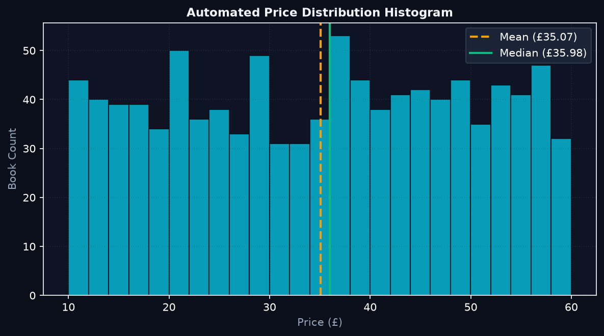
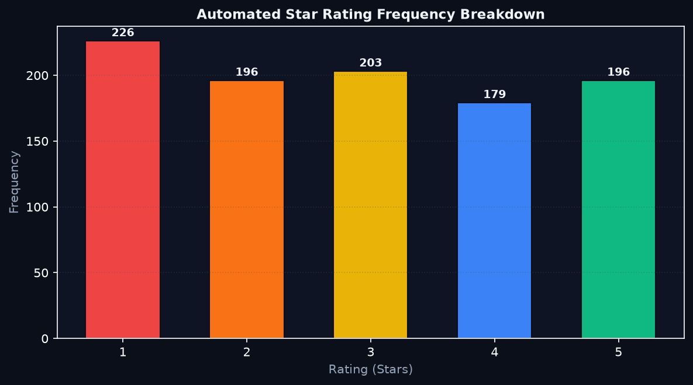
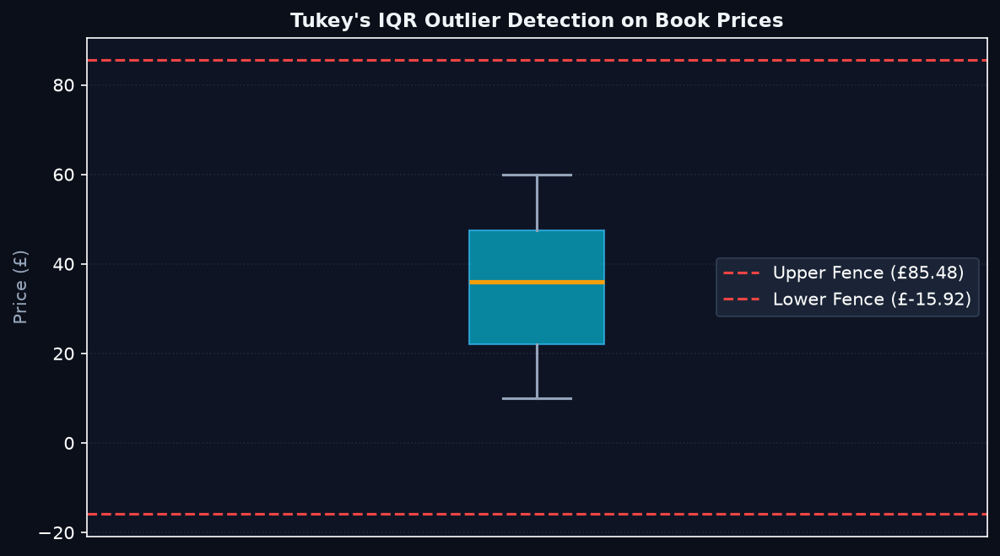

# Automated Exploratory Data Analysis Report
**Generated by DataLab Live Pipeline**  
**Dataset**: `books_dataset.csv`  
**Target Sandbox**: [books.toscrape.com](https://books.toscrape.com/)  

---

## 1. Executive Summary & Dataset Dimensions

| Metric | Measured Value |
| :--- | :--- |
| **Total Observations (Rows)** | 1,000 |
| **Feature Count (Columns)** | 4 |
| **Column Names** | `title, price, rating, availability` |
| **Duplicate Book Titles** | 1 |
| **Encoding Standard** | UTF-8 with BOM (`utf-8-sig`) |

---

## 2. Data Health & Missing Value Audit

| Column Name | Inferred Dtype | Missing Count | Null Percentage |
| :--- | :--- | :--- | :--- |
| `title` | `string` | 0 | 0.0% |
| `price` | `float64` | 0 | 0.0% |
| `rating` | `int64` | 0 | 0.0% |
| `availability` | `string` | 0 | 0.0% |

> **Audit Finding**: The dataset is 100% complete with 0 null values across all acquired fields. Exactly 1 title duplication was identified.

---

## 3. Parametric & Non-Parametric Price Statistics

| Statistical Indicator | Value (£ GBP) | Notes |
| :--- | :--- | :--- |
| **Sample Mean** | £35.07 | Arithmetic average |
| **Standard Deviation** | £14.45 | Measure of dispersion |
| **Minimum Value** | £10.00 | Lowest priced book |
| **25th Percentile (Q1)** | £22.11 | 25% of books cost less than this |
| **50th Percentile (Median)** | £35.98 | Middle price |
| **75th Percentile (Q3)** | £47.46 | 75% of books cost less than this |
| **Maximum Value** | £59.99 | Highest priced book |
| **Interquartile Range (IQR)** | £25.35 | Spread of central 50% |

---

## 4. Outlier Analysis (Tukey's IQR Fences)

- **Lower Fence**: `Q1 - 1.5 * IQR` = **£-15.92**
- **Upper Fence**: `Q3 + 1.5 * IQR` = **£85.48**
- **Flagged Outlier Records**: **0 books**

### Rationale for Zero Outliers
The books catalog prices are roughly uniformly distributed across the £10 to £60 spectrum. Uniform distributions lack extreme tail events, causing all 1,000 observations to fall well within the calculated boundary interval `[£-15.92, £85.48]`.

---

## 5. Visual Artifacts

### Figure 1: Price Distribution

### Figure 2: Rating Frequencies

### Figure 3: Outlier Boxplot

---
*Report automatically generated by `python generate_eda_report.py`.*
